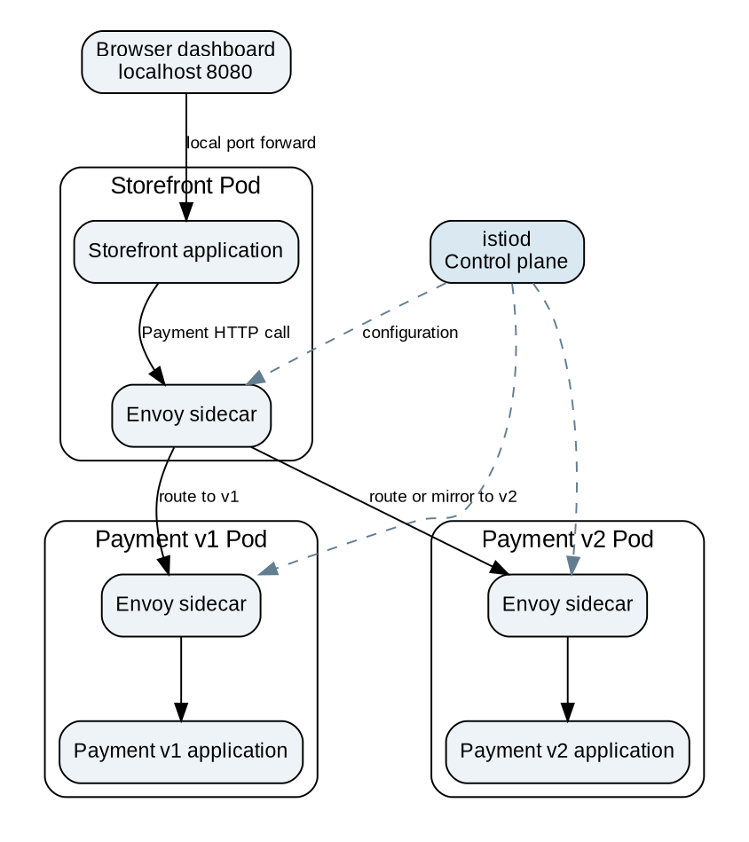

<<<<<<< HEAD
# Mesh Shop Istio KT Lab

A small, read-only shopping demo for learning service-to-service routing and recording a knowledge transfer video. You get a storefront, Payment v1, Payment v2 and eleven alternative Istio policies. The UI shows version counts, status, latency and backend attempt number.

This is an interview practice project. Describe it as a lab you built and demonstrated; it is not evidence of production operations experience. No payment is processed or persisted.

## Start here

1. Read `docs/SETUP.md` and prepare a disposable Kubernetes cluster with Istio sidecar mode.
2. In PowerShell, from the extracted project directory, run `./scripts/setup.ps1`.
3. In a second terminal, run `kubectl port-forward -n istio-kt svc/storefront 8080:8080`.
4. Open **http://localhost:8080** and click **Send one request**. Payment v1 should answer.
5. Follow `docs/KT_RUNBOOK.md`. Apply one scenario at a time and use its test command.
6. Use `docs/INTERVIEW.md` to practise explaining the results.

The app does not implement routing, retries or fault injection. It forwards request headers and a path to a fixed Payment Service. Istio applies the policy on that mesh call.

## Architecture

The browser reaches Storefront through a local port-forward. Storefront then calls `payment:8080` through its Envoy sidecar. The proxies apply the selected route and reach a Payment Pod. istiod distributes configuration and certificates; normal requests do not pass through istiod.

Port-forwarding is a development shortcut and can bypass inbound proxy processing. It is used only to open the UI. The traffic-routing demonstration concerns the **Storefront to Payment** call, which originates inside the mesh. This exercise does not test public ingress routing or gateway TLS termination.

## The eleven scenarios

| Number | Policy file | What you demonstrate |
|---|---|---|
| 1 | `01-all-v1.yaml` | Baseline and rollback to v1 |
| 2 | `02-all-v2.yaml` | Full switch to v2 |
| 3 | `03-weighted.yaml` | Approximate 90/10 canary split |
| 4 | `04-header.yaml` | Route `x-canary: yes` to v2 |
| 5 | `05-path.yaml` | Route `/preview` to v2 |
| 6 | `06-cookie.yaml` | Route `canary=yes` cookie to v2 |
| 7 | `07-mirror.yaml` | Return v1 response and copy traffic to v2 |
| 8 | `08-delay.yaml` | Delay matching traffic by two seconds |
| 9 | `09-abort.yaml` | Abort matching traffic with HTTP 503 |
| 10 | `10-timeout.yaml` | End a three-second backend call after one second |
| 11 | `11-retry.yaml` | Retry a read-only call that fails twice |

All scenario files define the **same VirtualService identity**. Applying another scenario replaces its specification. Keep the DestinationRule applied. Do not apply the whole scenarios directory: only the last configuration would remain, which hides the intent of the demonstration.

## What is in the project

- `src/` — Python standard-library HTTP app and a browser dashboard; no pip dependencies.
- `k8s/` — namespace, service accounts, Services and three Deployments.
- `istio/` — destination subsets, routing scenarios and optional security/access logs.
- `scripts/` — PowerShell setup, scenario selection and request generation.
- `docs/` — setup, demonstration script, expected results, diagnosis and interview notes.
- `tests/` — local HTTP tests, static manifest checks and an opt-in live mesh check.
- `Dockerfile` — optional image build. Default setup mounts source from a ConfigMap into the Python image so you do not need to build or publish an image first.

## Validation and limits

See `VALIDATION.md` for checks actually run. Local application tests and static consistency checks do not validate an Envoy runtime. A live Kubernetes/Istio test is still required on your laptop. Faults and timeouts depend on your cluster and policy propagation; expected results are documented, not claimed as observed mesh results.

For a production deployment you would pin image digests, review dependency and cluster support, add persistence only if required, design identities and network policy, protect dashboards, measure resource limits and rehearse upgrades. This learning app uses a threaded Python HTTP server and is not a production web server.
=======
# ISTIO-Project
>>>>>>> origin/main
